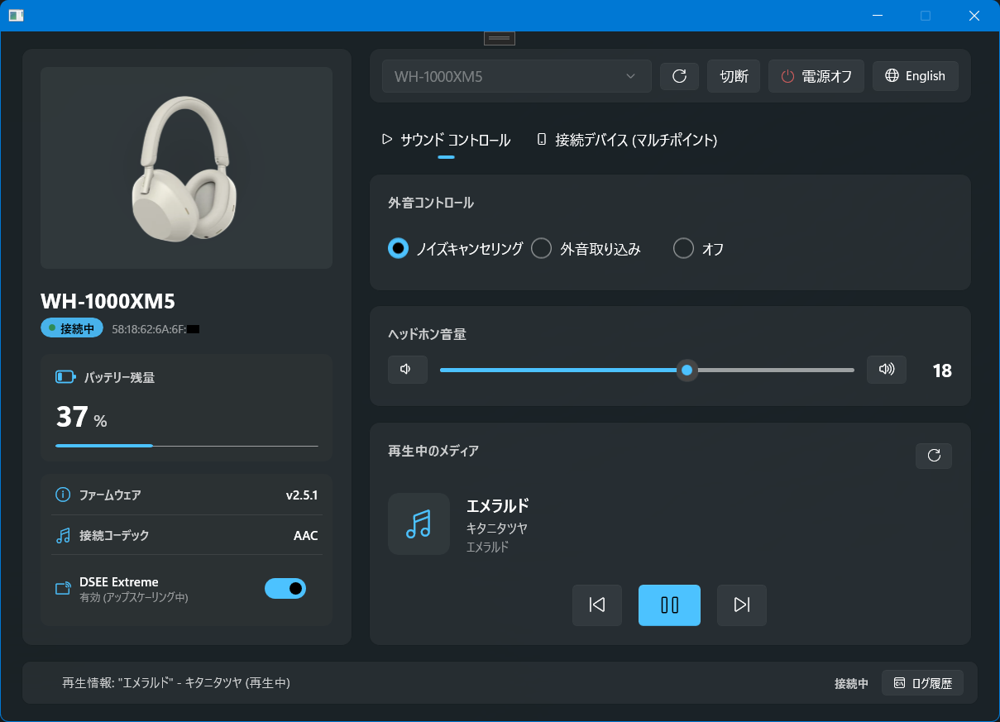
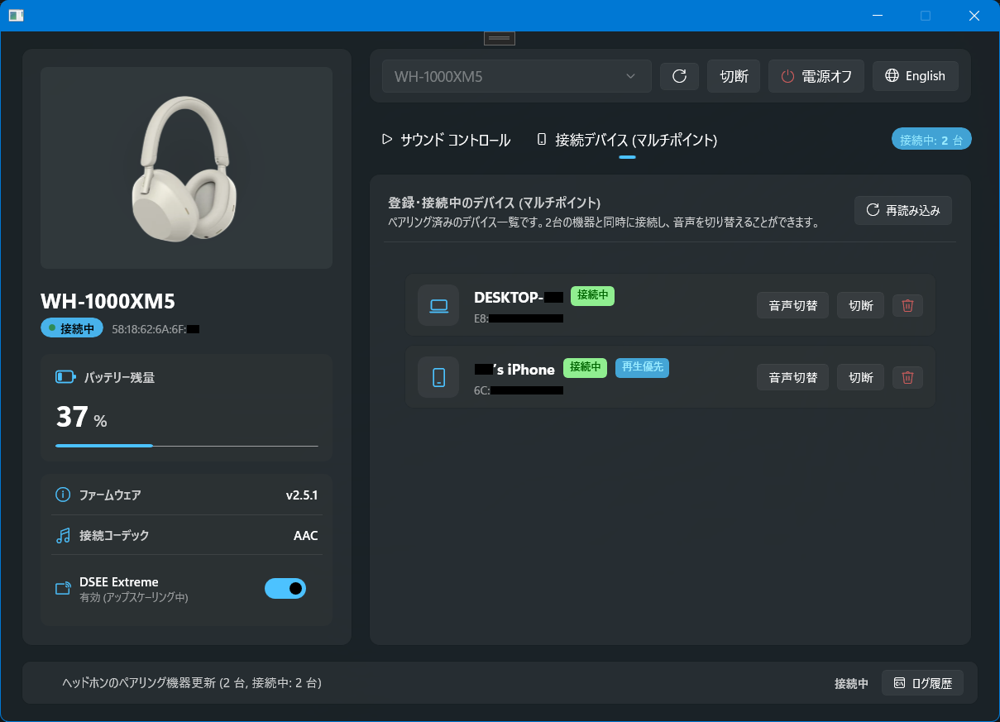
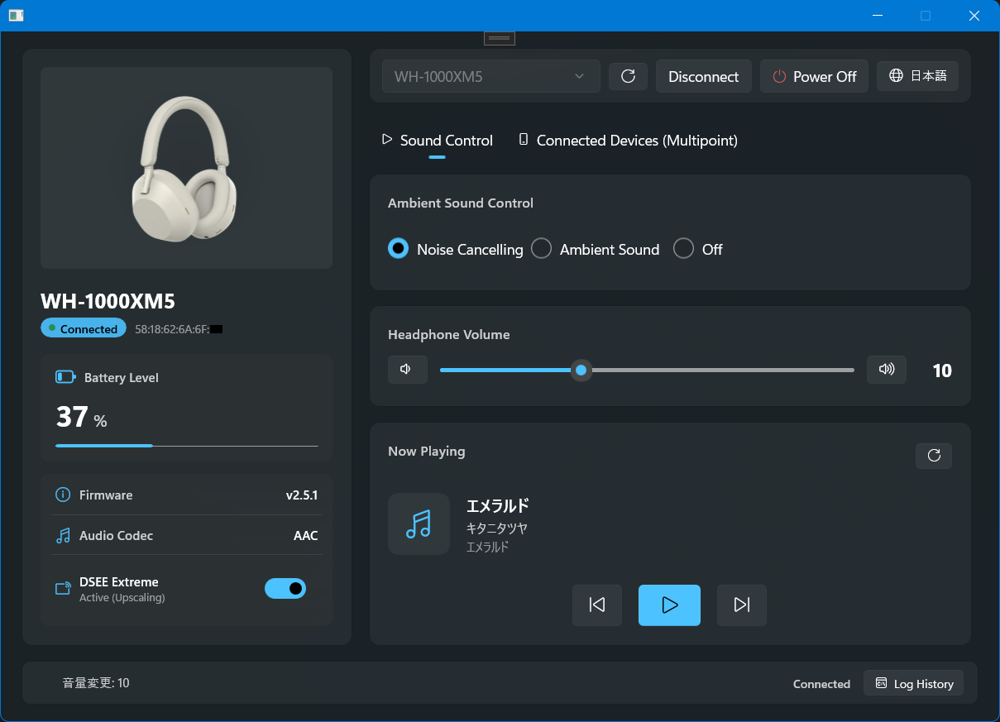
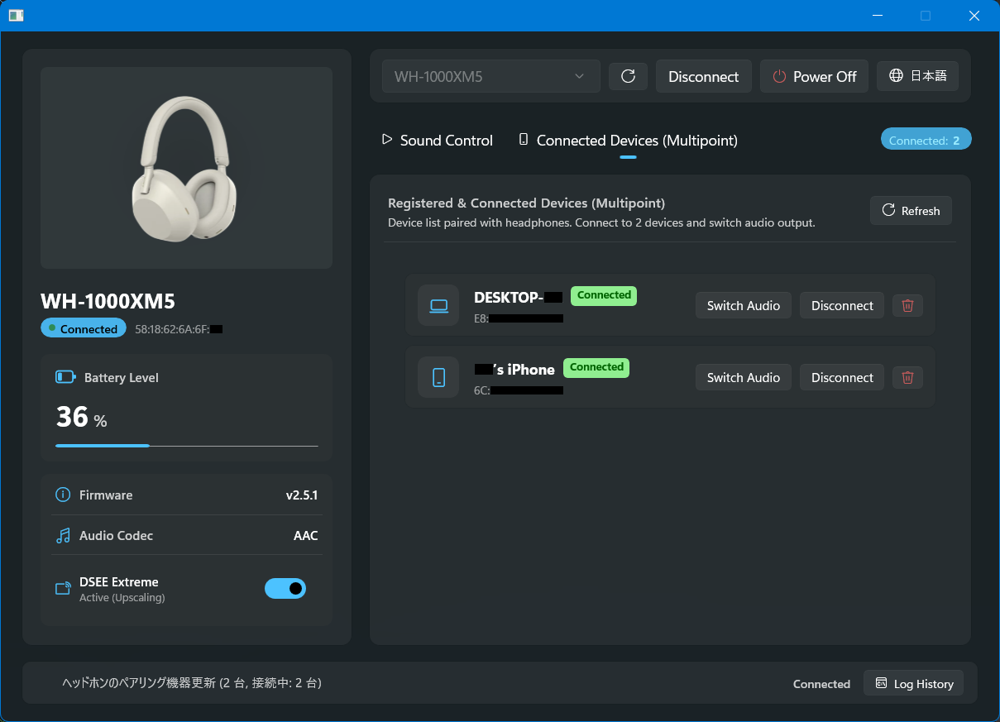

# Sony Headphones Controller for Windows

### 言語 / Language : 日本語 | [English](README_EN.md)

> [!IMPORTANT]
> 本プロジェクトは、有志によるリバースエンジニアリング・解析情報に基づき作成されたオープンソースの非公式実装であり、Sony Corporation およびその関連会社とは一切関係ありません。

> [!NOTE]
> 本アプリは Windows 標準の Bluetooth RFCOMM ソケットを使用してヘッドホンと直接バイナリ通信を行います。サードパーティ製 Bluetooth ドライバは不要で、Windows 10 / 11 の標準機能のみで動作します。

## 概要

**Sony Headphones Controller** は、Sony 製 Bluetooth ヘッドホン（現時点では WH-1000XM5 のみ）を Windows PC から快適に制御できる、WinUI 3 / .NET 8 ベースのモダンなデスクトップアプリケーションです。

公式スマートフォンアプリ（Sony Headphones Connect / Sound Connect）でしか操作できなかったノイズキャンセリングや外音取り込みレベルの調整、マルチポイント（2台同時接続）機器の切り替え、DSEE 音質向上のオン/オフなどを、Windows デスクトップ上で美しく直感的に操作できます。

---

## スクリーンショット

### 日本語版 (Japanese UI)

| サウンド・メディアコントロール | 接続デバイス管理 (マルチポイント) |
| :---: | :---: |
|  |  |

### 英語版 (English UI)

| Sound & Media Control | Connected Devices (Multipoint) |
| :---: | :---: |
|  |  |

---

## 主な機能

- 🎧 **外音コントロール (NC / ASM)**
  - ノイズキャンセリング、外音取り込み（アンビエントサウンド）、オフのワンクリック切り替え
  - 外音取り込みレベル（1〜20段階）のシームレススライダー調整（通信最適化デバウンス制御付き）
  - 人の声を強調して聞き取りやすくする「ボイスフォーカス」機能のトグル
- 🔊 **音量コントロール ＆ 再生中メディア情報**
  - ヘッドホンの内部再生音量の同期・調整（ステップボタンおよびスライダー）
  - Bluetooth 経由での楽曲メタデータ（曲名、アーティスト名、アルバム名）のリアルタイム取得・表示
  - 再生 / 一時停止 / 次の曲 / 前の曲のトラックコントロール
- 🪄 **音質ステータス ＆ DSEE 双方向操作**
  - 現在の伝送コーデック（LDAC / AAC / SBC 等）のリアルタイム表示
  - DSEE（DSEE Extreme / HX）の動作状態（有効 / 休止中 / オフ）表示
  - GUI 上のトグルスイッチから DSEE の有効（Auto）/ 無効（Off）を実機へ即時送信・切り替え
- 🔄 **マルチポイント接続デバイス管理 (Table 2 プロトコル)**
  - ヘッドホン内部に記憶されているペアリング済み機器一覧（PC、スマートフォン、タブレット等）の取得・表示
  - 接続中機器および現在音声出力中の機器のリアルタイムバッジ表示
  - 「音声切替」ボタンによる出力先機器の即時スイッチ
  - ペアリング済み機器への接続、切断、およびペアリング情報の解除（削除）
- 🌐 **シームレスな多言語対応 (日本語 / 英語)**
  - OS の表示言語（`CurrentUICulture`）に応じた自動初期化
  - 画面右上の言語ボタンから、アプリ再起動なしで UI 全体のテキストを即座に相互切り替え
- 📊 **常駐ステータスバー ＆ フローティング通信ログ**
  - 接続状態、バッテリー残量、充電ステータスの一目でわかる表示
  - メインUIを押し上げずに下部に重なって開く「フローティング通信ログオーバーレイ」
  - 送受信された MDR バイナリパケットや状態変更イベントのリアルタイム履歴確認

---

## 仕組みとアーキテクチャ

本ソリューションは、以下の 2 つのプロジェクトで構成されています。

```
[SonyHeadphoneWH] (WinUI 3 / Windows App SDK / .NET 8)
   │  - Mica バックドロップ採用の Fluent Design GUI
   │  - MVVM パターン (MainViewModel, デバウンス制御, フィードバックループ防止)
   │  - 多言語サービス (LocalizationService)
   ▼
[SonyHeadphonesNet] (.NET 8 クラスライブラリ)
   │  - MDR V2 Table 1 / Table 2 プロトコルスタック (フレーミング, バイトエスケープ, ACK返信)
   │  - Winsock RFCOMM ネイティブ通信 (ws2_32.dll AF_BTH / BTHPROTO_RFCOMM)
   │  - デバイス制御抽象化 (ISonyHeadphoneDevice, SonyHeadphoneBase, Wh1000Xm5Device)
   ▼
[Bluetooth RFCOMM / Sony WH-1000XM5 実機]
```

### MDR プロトコル通信仕様
- **RFCOMM サービス UUID (MDR V2)**: `956C7B26-D49A-4BA8-B03F-B17D393CB6E2`
- **パケット構造**: 開始マーカー `0x3E ('>')`、エスケープ済みデータ列、終了マーカー `0x3C ('<')`
- **パケットタイプ**:
  - `DATA_MDR` (`0x0C`): 音量、ノイズコントロール、再生制御、DSEE、コーデックなど
  - `DATA_MDR_NO2` (`0x0E`): マルチポイント接続機器管理、音声出力元切り替えなど
  - `ACK` (`0x01`): ヘッドホンからの受信確認応答（自動返信）

---

## 導入とビルド方法

### 動作要件
- **OS**: Windows 10 (バージョン 1809 以降) / Windows 11
- **ハードウェア**: Bluetooth 4.0 以上を搭載した Windows PC
- **開発環境 (ビルド時のみ)**: .NET 8.0 SDK, Visual Studio 2026 (Windows アプリケーション開発ワークロード)

### 1. ヘッドホンのペアリング
Windows の標準設定（「設定」>「Bluetooth とデバイス」）から、お使いの Sony ヘッドホン（例: WH-1000XM5）をあらかじめペアリングしておきます。

### 2. リポジトリのクローンとビルド
```bash
git clone https://github.com/NeonGraff/Sony_WH-1000XM5_Controller_WinUI3.git
cd Sony_WH-1000XM5_Controller_WinUI3

# x64 リリースビルド
dotnet build SonyHeadphoneWH/SonyHeadphoneWH.csproj -c Release -p:Platform=x64
```

### 3. アプリの起動
ビルド完了後、生成された実行ファイルまたは Visual Studio から起動します。
画面上部のセクションからペアリング済みのヘッドホンを選択し、「接続」をクリックするだけで通信が開始されます。

---

## ライセンス

### 謝辞 (Acknowledgments)

本プロジェクトの MDR プロトコル解析および通信仕様の理解にあたり、以下のオープンソースプロジェクトの実装およびリバースエンジニアリング成果を大いに参考にさせていただきました。素晴らしい知見を公開してくださっている作者の皆様に深く感謝いたします。

[**SonyHeadphonesClient** (by mos9527, Amr Satrio and contributors)](https://github.com/mos9527/SonyHeadphonesClient)
```text
MIT License

Copyright (c) 2026 mos9527, Amr Satrio and other contributors

Permission is hereby granted, free of charge, to any person obtaining a copy
of this software and associated documentation files (the "Software"), to deal
in the Software without restriction, including without limitation the rights
to use, copy, modify, merge, publish, distribute, sublicense, and/or sell
copies of the Software, and to permit persons to whom the Software is
furnished to do so, subject to the following conditions:

The above copyright notice and this permission notice shall be included in all
copies or substantial portions of the Software.

THE SOFTWARE IS PROVIDED "AS IS", WITHOUT WARRANTY OF ANY KIND, EXPRESS OR
IMPLIED, INCLUDING BUT NOT LIMITED TO THE WARRANTIES OF MERCHANTABILITY,
FITNESS FOR A PARTICULAR PURPOSE AND NONINFRINGEMENT. IN NO EVENT SHALL THE
AUTHORS OR COPYRIGHT HOLDERS BE LIABLE FOR ANY CLAIM, DAMAGES OR OTHER
LIABILITY, WHETHER IN AN ACTION OF CONTRACT, TORT OR OTHERWISE, ARISING FROM,
OUT OF OR IN CONNECTION WITH THE SOFTWARE OR THE USE OR OTHER DEALINGS IN THE
SOFTWARE.
```

### 商標について (Trademarks)

- "Sony", "WH-1000XM5", "LDAC", "DSEE", "DSEE Extreme", "Headphones Connect", "Sound Connect" は、Sony Corporation またはその関連会社の登録商標または商標です。
- "Windows" は、Microsoft Corporation の商標または登録商標です。
- "Bluetooth" は、Bluetooth SIG, Inc. の登録商標です。
- その他記載されている会社名および製品名は、各社の商標または登録商標です。

### 本プロジェクトのライセンス (License)

本ソフトウェアは [MIT License](LICENSE) の下で公開されています。
個人利用、商用利用、改変、再配布が自由に認められています。
